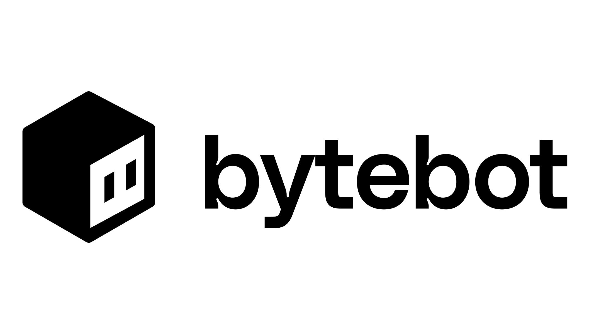

<div align="center">



# Byte Agent: Open-Source AI Desktop Agent

**An AI agent with its own virtual desktop to complete complex tasks autonomously**

[](LICENSE)

</div>

---

## What is a Desktop Agent?

A desktop agent is an AI that has access to its own computer environment. Unlike browser-only agents or traditional RPA tools, this agent operates within a full virtual desktop where it can:

- Use desktop applications (browsers, email clients, office tools, IDEs)
- Download and organize files with its own file system
- Log into websites and applications securely
- Read and process documents, PDFs, and spreadsheets
- Complete complex multi-step workflows across different programs

Think of it as an autonomous digital assistant that can view the screen, control the mouse, use keyboard shortcuts, and accomplish tasks end-to-end.

## Key Capabilities

### Complete Task Autonomy
Assign tasks like *"Download all invoices from vendor portals and organize them into a folder"* and the agent will:
- Open the browser
- Navigate to each portal
- Handle authentication
- Download files to the local file system
- Organize files into designated directories

### Document & Data Processing
Process files directly in the desktop environment:
- Read PDFs, CSVs, and spreadsheets into context
- Extract structured data from complex documents
- Cross-reference information across multiple files
- Generate reports and summary documents based on findings

### Real Application Interaction
Operate genuine desktop software:
- Run applications like text editors, VS Code, or email clients
- Execute scripts and command-line utilities
- Install and configure new software for specific workflows

---

## Quick Start

### Prerequisites
- [Docker](https://docs.docker.com/get-docker/) & Docker Compose
- API key from Anthropic, OpenAI, or Google Gemini

### Getting Started with Docker Compose

1. **Clone the repository:**
   ```bash
   git clone https://github.com/Chintan-Makvana/byte_agent.git
   cd byte_agent
   ```

2. **Configure your AI provider API key:**
   ```bash
   # In docker/.env (choose your provider):
   echo "ANTHROPIC_API_KEY=sk-ant-..." > docker/.env
   # Or: echo "OPENAI_API_KEY=sk-..." > docker/.env
   # Or: echo "GEMINI_API_KEY=..." > docker/.env
   ```

3. **Start the containers:**
   ```bash
   docker-compose -f docker/docker-compose.yml up -d
   ```

4. **Access the application:**
   - Open [http://localhost:9992](http://localhost:9992) in your browser.

---

## Architecture & How It Works

The system consists of four integrated components:

1. **Virtual Desktop**: An Ubuntu Linux environment running XFCE with pre-installed applications and utilities.
2. **AI Agent**: A NestJS service that coordinates LLM reasoning and converts goals into desktop actions.
3. **Task Interface**: A Next.js web UI where you can dispatch tasks, manage files, and observe real-time progress.
4. **APIs**: REST & WebSocket endpoints for programmatic task orchestration and desktop control.

### Features
- **Natural Language Tasks**: Instruct the agent in plain English.
- **File Uploads**: Attach files to tasks for the agent to inspect and process.
- **Live Desktop View**: Monitor the agent's actions in real-time.
- **Takeover Mode**: Manually intervene whenever you need to guide or configure something.
- **Persistent Storage**: Retain software, configurations, and downloaded files between tasks.

---

## Programmatic Control

### Create Tasks via API

```python
import requests

# Create a simple task
response = requests.post('http://localhost:9991/tasks', json={
    'description': 'Download the latest sales report and create a summary'
})

# Create a task with file attachments
files = {'files': open('document.pdf', 'rb')}
response = requests.post(
    'http://localhost:9991/tasks',
    data={'description': 'Review these files and extract important dates'},
    files=files
)
```

### Direct Desktop Actions

```bash
# Capture a screenshot
curl -X POST http://localhost:9990/computer-use \
  -H "Content-Type: application/json" \
  -d '{"action": "screenshot"}'

# Click at specific coordinates
curl -X POST http://localhost:9990/computer-use \
  -H "Content-Type: application/json" \
  -d '{"action": "click_mouse", "coordinate": [500, 300]}'
```

---

## Example Tasks

- **Research & Summarization:**
  - *"Go to Wikipedia and create a summary of quantum computing."*
  - *"Research flights from NYC to London and save the findings into a document."*
- **Document Processing:**
  - *"Read the uploaded contracts.pdf and extract all payment terms and deadlines."*
  - *"Process these invoice PDFs and compile a summary table."*
- **Multi-App Workflows:**
  - *"Download last month's statements and consolidate them into a single report."*
  - *"Log into the portal, export customer records, and verify them against the local spreadsheet."*

---

## License

This project is licensed under the [Apache 2.0 License](LICENSE).
